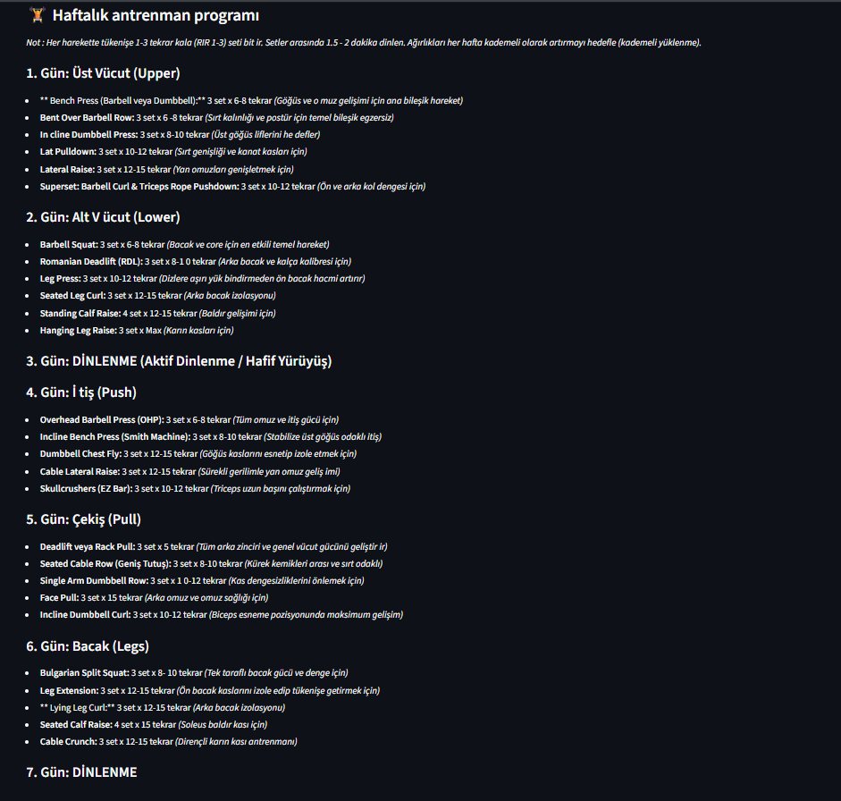

# 💪 Spor Başlangıç Asistanı

Spora yeni başlayanlar için yapay zekâ destekli kişisel başlangıç planı. Kısa bir form dolduruyorsun; uygulama sana
**haftalık antrenman programı**, **kalori ve makro hedefleri**, **bütçene göre supplement planı** ve **sağlık uyarısı** veriyor.

🔗 **Canlı demo:** _(yayınlanınca buraya eklenecek)_



## Özellikler

- **Kişiye özel antrenman:** Gün sayısı, seviye, ev/salon ve hedefe göre bölünme (full body, üst/alt, PPL).
  Güncel spor bilimine dayanır (kademeli yüklenme, RIR, haftalık set hacmi).
- **Kalori ve makro hesabı:** Mifflin-St Jeor formülüyle; hedefe göre cut / lean bulk / koruma.
  Hesaplar yapay zekâ ile değil, kodla yapılır.
- **Bütçeye göre supplement planı:** Kanıtı olan ürünlerden oluşan bir katalogdan, seviyeye ve hedefe göre
  bütçeyi dolduran seçim; her ürün için kullanım notları.
- **Güvenlik kuralları:** 18 yaş altı veya sağlık durumu belirten kullanıcıya supplement ve kalori hedefi verilmez,
  uzmana yönlendirilir. Yağ yakıcı, hormon benzeri ürün ve aktar karışımları önerilmez. Doz yazılmaz.
- **Dayanıklı yapay zekâ bağlantısı:** Model meşgulse bekleyip tekrar dener, gerekirse yedek modele geçer;
  cevap ekrana akarak gelir.

## Kullanılan teknolojiler

Python · Streamlit · Google Gemini API (`google-genai`) · python-dotenv

## Bilgisayarında çalıştırma

```bash
git clone https://github.com/ercansariabaci/spor-asistani.git
cd spor-asistani
python -m venv .venv
.venv\Scripts\Activate.ps1        # macOS/Linux: source .venv/bin/activate
pip install -r requirements.txt
```

Proje klasöründe `.env` dosyası oluştur (ücretsiz anahtar: https://aistudio.google.com):

```
GEMINI_API_KEY=senin-anahtarın
GEMINI_MODEL=gemini-3.5-flash
```

Çalıştır:

```bash
streamlit run app.py
```

## Proje yapısı

| Dosya | Görevi |
|---|---|
| `app.py` | Arayüz (form, sonuçlar) ve Gemini bağlantısı |
| `prompts.py` | Sistem prompt'u ve kullanıcı mesajı |
| `hesaplamalar.py` | Kalori ve makro hesapları |
| `supplementler.py` | Supplement kataloğu ve bütçeye göre seçim |
| `test_gemini.py` | Gemini bağlantısını tek başına test eden küçük script |
| `.streamlit/config.toml` | Tema renkleri |

## Yol haritası

- [x] **Sürüm 1:** Başlangıç asistanı (form → plan)
- [ ] **Sürüm 2:** Supplement planlayıcısı ve günlük zaman çizelgesi
- [ ] **Sürüm 3:** Hesap sistemi, geçmiş planlar, ilerleme takibi (FastAPI + React)
- [ ] **Sürüm 4:** Topluluk ve deneyim paylaşımı

## ⚠️ Uyarı

Bu uygulama sağlık tavsiyesi vermez; genel bilgilendirme amaçlıdır. Yeni bir antrenman, beslenme veya supplement
programına başlamadan önce bir doktora veya uzmana danış. Fiyatlar tahminidir.
